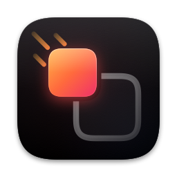
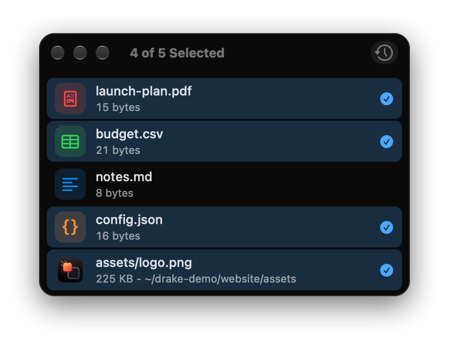
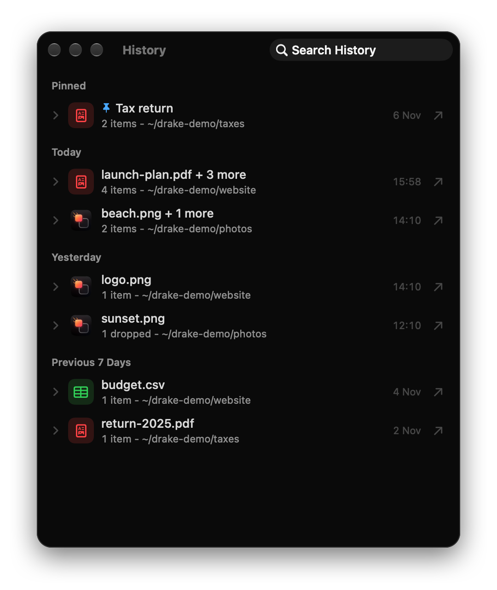

<p align="center">
  
</p>

<h1 align="center">drake</h1>

<p align="center">
  Drag and drop from the command line on macOS, with a history of past runs.<br>
  A native take on <a href="https://github.com/mwh/dragon">mwh/dragon</a>.
</p>

---

Web apps, chat apps and browsers want files *dragged* into them. If you live in
a terminal rather than Finder, that is awkward. drake fixes it:

```sh
drake report.pdf screenshot.png
```

opens a small window holding those files, ready to drag wherever you need them.
Everything starts selected, so one drag sends the lot.

<p align="center">
  
  
</p>

## Install

```sh
git clone git@github.com:marcosfons/drake.git
cd drake
make install          # app in ~/.local/lib, `drake` in ~/.local/bin, man page
```

Requires macOS 26 and Xcode 26 or later. No developer certificate is needed:
the app is signed to run locally. If `~/.local/bin` is not on your `PATH`, add
`export PATH="$HOME/.local/bin:$PATH"` to `~/.zshrc`.

`make PREFIX=/usr/local install` installs elsewhere, `make NAME=dd install`
under another command name, and `make uninstall` removes it all.

## Use

| | |
|---|---|
| `drake a.txt b.pdf` | a window holding those files, ready to drag out |
| `drake --target` | a window to drag files *into*; drops are printed to stdout |
| `drake --target --keep` | as above, and each drop stays draggable |
| `drake -x f.txt` | quit as soon as one drag lands |
| `drake --all *.png` | one control that drags everything at once |
| `find . -name '*.log' \| drake --stdin` | take filenames from a pipe |
| `drake` | browse the history of previous runs |

Every dragon option works (`-x -t -k -p -a -A -i -f -F -T -I -s -v`, `--help`,
`--version`), plus `--history`, `--no-history` and `--no-animation`. See
`man drake`.

### History

Runs with files are kept in `~/Library/Application Support/Drake/history.json`.
`drake` with no arguments lists them by date: expand a run to drag single items
out of it, drag the whole run at once, or double-click to reopen it. Search with
⌘F; rename, pin or remove from the context menu.

### Keys

| | |
|---|---|
| Click, ⌘-click, ⇧-click, sweep | select, toggle, extend, rubber-band |
| ↑ / ↓ | move the selection (⇧ extends) |
| ⌘O ⌘R ⌘C | open, reveal in Finder, copy paths |
| Delete | remove the selected rows from the list |
| ⌘Y / ⌘[ / ⌘F | history / back / search history |
| Escape, `q`, ⌘W | close (`q` also works in the launching terminal) |

### Dragging into picky apps

A dragged file carries a file URL and nothing else, exactly like Finder, so any
app that accepts files from Finder accepts them from drake. WhatsApp also
refuses text-type files (`.md`, `.json`, `.csv`, code) even from Finder; drake
notices when a drag reaches a WhatsApp window and hands those over as plain
attachments instead.

### A global shortcut

Shortcuts.app can bind drake to a key: create a shortcut with a **Run Shell
Script** action running `$HOME/.local/bin/drake`, then give it a keyboard
shortcut such as ⌃⌥⌘D. With no arguments it opens the history, which is
usually what you want from a hotkey. `make check-shortcut KEY=ctrl+opt+cmd+D`
tells you whether macOS already uses a combination.

## When something goes wrong

drake logs to the unified log under `com.marcos.Drake`:

```sh
make log              # the last hour
drake --verbose …     # the same messages, on stderr
```

Warnings and errors are also kept in `~/Library/Logs/Drake/drake.log`, which
**Help ▸ Show Problem Log** opens in Console.

## Development

```sh
make          # Release build
make test     # unit tests
```

| | |
|---|---|
| `Drake/App/` | entry point, app delegate, window, toolbar, menu bar |
| `Drake/Model/` | options, items, selection, history, the app model |
| `Drake/Views/` | the screens, rows, icons and theme |
| `Drake/AppKit/` | drag source, drop target, pasteboard, sweep selection |
| `Drake/Support/` | geometry, logging, thumbnails, file-type icons |
| `DrakeTests/` | unit tests, one file per subject |
| `man/drake.1` | the man page, installed by `make install` |
| `docs/` | README screenshots |
| `tools/` | the app icon generator and the shortcut checker |

`CLAUDE.md` holds the project's conventions and code-quality rules.

## License

GPL-3.0, as dragon is. See [LICENSE](LICENSE).
